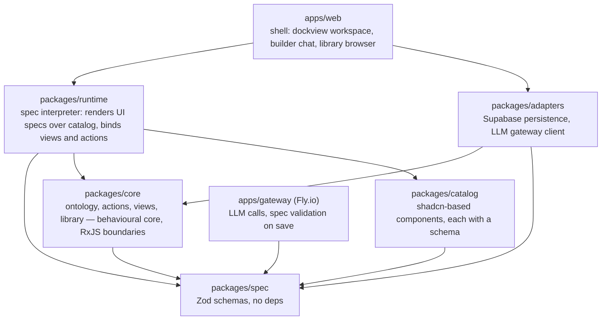

# Origamic — Architecture

## Glossary

Agents misuse these words unless pinned. Use them exactly.

- **Ontology** — the set of `ObjectType`, `Property`, `LinkType` and
  `ActionType` definitions. Versioned as a whole. The only thing apps bind to.
- **Object** — an instance of an `ObjectType`. Stored by the persistence
  adapter; never addressed by table or column outside it.
- **Action** — a named write with an input schema and validation rules.
  The only way state changes.
- **View** — a read: a query over the ontology, declared in a spec, optionally
  materialised. Views never write.
- **Catalog** — the fixed set of UI components the runtime can render, each
  described by a Zod schema (props in, events out). The model may only
  reference catalog entries.
- **UI spec** — a tree of catalog component references with bindings to
  views and actions.
- **App** — a saved tuple `(ontology slice, ui spec, actions, bindings)` with
  a version.
- **Workspace** — a saved layout of apps in dockview panels, itself a spec.
- **Library** — the store of apps and workspaces.
- **Spec** — any of the above when stored as data. Never means "code".
- **Runtime** — the client that interprets specs. Never generated.

## Layers and the dependency rule



Rules, each to be enforced as an import ban in `tools/arch`:

1. `packages/spec` imports nothing but `zod`.
2. `packages/core` imports `spec` only. No React, no Supabase, no DOM.
3. `packages/catalog` imports `spec` and React. No `core`, no `adapters`.
   A catalog component is a pure function of its props and emits events;
   it never fetches, never reads global state.
4. `packages/runtime` imports `spec`, `core`, `catalog`. Never `adapters`.
5. `packages/adapters` is the only place that knows about Supabase tables,
   SQL, HTTP, or the LLM API.
6. `apps/web` wires `runtime` to `adapters`. It contains no business logic.
7. Nothing outside `adapters` names a table, a column or a query string.

## The behavioural core (`packages/core`)

Framework-agnostic. Ports as interfaces; streams as RxJS observables at the
boundaries. The ports in v1:

```ts
interface OntologyStore {
  current(): Observable<Ontology>;
  propose(migration: OntologyMigration): Promise<OntologyVersion>;
}
interface ObjectStore {
  view(query: ViewQuery): Observable<ObjectPage>;
  execute(action: ActionInvocation): Promise<ActionResult>;
}
interface SpecLibrary {
  list(): Observable<LibraryEntry[]>;
  load(id: AppId, version?: SpecVersion): Promise<AppSpec>;
  save(spec: AppSpec): Promise<SpecVersion>;
}
interface LlmGateway {
  generate(req: GenerationRequest): Observable<GenerationEvent>;
}
```

Supabase and the Fly.io gateway are adapters behind these. The thin TSX in
`runtime` and `apps/web` subscribes to these streams and dispatches actions;
it holds no state of its own beyond what dockview needs for layout.

## Persistence model (see ADR-0001)

v1 stores objects in a single JSONB `objects` table plus a `links` table, keyed
by `object_type@version`. No per-type tables. The ontology itself is data in
an `ontology_versions` table. Compilation to real tables is a later
optimisation that the dependency rule keeps invisible to everything above
`adapters`.

## Generation model

The model is called with: the current ontology (or a retrieved slice), the
catalog's schemas, the action protocol, and the user's intent. It must return
specs that validate against `packages/spec`. Invalid output is rejected and
the error is fed back for one retry; a second failure is shown to the user.
The gateway validates on save as well, so a client cannot store an invalid
spec.

## Versioning

- The ontology has a monotonically increasing version. A change is a
  migration (`add type`, `add property`, `rename`, `deprecate`, …), stored as
  data, applied in order.
- An app spec carries its own version and the ontology version it was built
  against. Bindings reference `ObjectType@version`.
- Loading an app against a newer ontology runs a compatibility check; a
  breaking mismatch produces a migration proposal for the model to fill in,
  never a silent failure.

## Cross-app state (deferred)

Panels in a workspace will eventually share context (the selected object,
say). This will be FDC3-style channels over the RxJS boundary layer in
`core`, not shared React state. Not in v1; the port is left open by keeping
all app state in `core`.

## Security posture

Specs are data, so nothing the model emits is executed as code in v1. When
sandboxed functions arrive (post-v1), they run in an isolate (QuickJS in a
worker or equivalent), are typed against the ontology, and are type-checked
before being stored. LLM keys live only in the Fly.io gateway. Supabase RLS
is enabled from day one even with a single user, keyed on ownership.

## What this architecture is optimising for

Being able to say, for every user-facing capability: here is the action,
here is its input schema, here is the view it reads — without naming a
component. That is what makes the app composable by a model, exposable as
tools (MCP / WebMCP) later, and testable without a browser.
