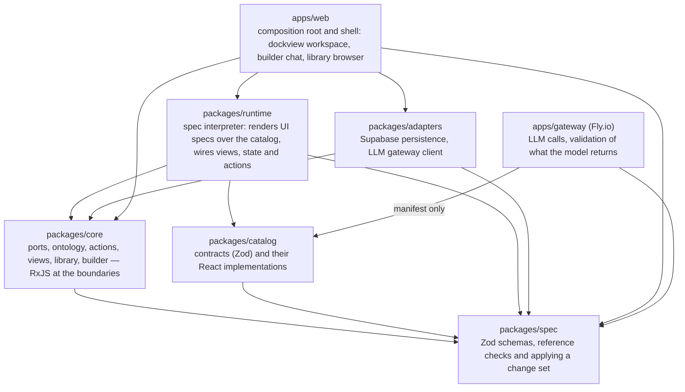

# Origamic — Architecture

The decisions behind this page are the records under [adr/](adr/). The first
reading of these documents, and what it settled, is
[reviews/2026-10-14-first-reading.md](reviews/2026-10-14-first-reading.md).

## Glossary

Agents misuse these words unless pinned. Use them exactly.

- **Ontology** — the set of `ObjectType`, `Property`, `LinkType` and
  `ActionType` definitions of one owner. Versioned as a whole, and each
  object type and action type also carries a version of its own (ADR-0005).
  The only thing apps bind to.
- **Object** — an instance of an `ObjectType`. Stored by the persistence
  adapter; never addressed by table or column outside it.
- **Action** — a named write, defined in the ontology, whose input is a set
  of its type's properties (ADR-0008). The only way state changes.
- **View** — a read: a query over one bound type, declared in a UI spec.
  Views never write. Materialised views are not in v1.
- **Catalog** — the fixed set of UI components the runtime can render. Each
  has a contract (a Zod schema of its props in Origamic's terms, the events
  it emits, a description) and an implementation (ADR-0010). The model may
  only reference catalog entries.
- **UI spec** — a flat map of elements, each naming a catalog component and
  wired to views, state and actions (ADR-0002).
- **Wiring** — what connects an element to the rest of its app: a prop that
  reads a view or a state key, an event that sets state or invokes an action.
- **Binding** — an app's reference into the ontology: `ObjectType@version`
  for a type it reads or writes, `action@version` for an action it invokes.
  Never a bare name.
- **App** — a saved spec: its UI spec, its bindings, the ontology version it
  was built against, and its own version.
- **Workspace** — a saved layout of apps in panels, itself a spec, in a
  layout format of Origamic's own (ADR-0003).
- **Library** — the store of apps and workspaces.
- **Change set** — a list of operations on the ontology, written against one
  ontology version and applied whole. Not called a "migration" here: that
  word is kept for the SQL files of the database.
- **Compatibility report** — what loading an app against a newer ontology
  returns when something it binds has changed in a way that breaks it.
- **Spec** — any of the above when stored as data. Never means "code".
- **Runtime** — the client that interprets specs. Never generated.

## Layers and the dependency rule



A rule has two halves, and the gates hold them apart: which of Origamic's own
packages a package may import, and which npm packages it may import. "`core`
imports `spec` only" was the first half alone; read literally it banned the
RxJS its ports return.

| Package | Imports, of ours | Imports, from npm |
|---|---|---|
| `packages/spec` | nothing | `zod` |
| `packages/core` | `spec` | `rxjs`, `zod` |
| `packages/catalog` | `spec` | `react`, `zod`, and the libraries its implementation is built from. Its manifest entry: `spec` and `zod` only |
| `packages/runtime` | `spec`, `core`, `catalog` | `react`, `rxjs` |
| `packages/adapters` | `spec`, `core` | `@supabase/supabase-js`, and nothing else names it; `rxjs`, for the ports it implements |
| `apps/web` | `runtime`, `adapters`, `core`, `spec` | `react`, `react-dom`, `dockview`, and nothing else names dockview |
| `apps/gateway` | `spec`, the catalog's manifest | `@anthropic-ai/sdk`, and nothing else names it; Node's built-ins |

And:

1. `packages/catalog`: a component is a pure function of its props and emits
   events; it never fetches and never reads global state. No prop passes
   through to what implements it (ADR-0010).
2. `packages/runtime` never imports `adapters`.
3. Of the packages that run in the browser, `packages/adapters` is the only
   one that knows about Supabase tables, SQL, HTTP or the gateway's address.
   The gateway is the only place that calls the model.
4. `apps/web` wires `runtime` to `adapters`. It contains no business logic.
5. Nothing outside `adapters` names a table, a column or a query string.

`architecture.config.mts` holds the table and rule 2, and `pnpm gate:full`
fails an import against them. Each package has a role of the starter's
kit; where a role would grant more than the table, the package has the role
`explicit`, whose edges are only the ones it writes down:

| Package | Role in `architecture.config.mts` |
|---|---|
| `packages/spec` | `leaf`: imports nothing, and every package may import it |
| `packages/core` | `core`, which also grants the starter's price list until the slice removes it |
| `packages/catalog` | `explicit`, naming `spec`; only `runtime` names it |
| `packages/runtime` | `bindings`, naming `catalog` |
| `packages/adapters` | `explicit`, naming `core` and `spec`; only the app will name it |

`react`, `zod` and `@supabase/supabase-js` may be imported only where the
table says. The two apps get their lines when they are made, in the first
slice. Rules 1, 4 and 5 cannot be decided from imports alone: they are
questions for a review. Rule 3 is held for libraries (only `adapters`
imports the Supabase client) and not for a `fetch` written by hand.

## The behavioural core (`packages/core`)

Framework-agnostic. Ports as interfaces; streams as RxJS observables at the
boundaries. Each port has a contract test, an in-memory simulator in `core`
and a real adapter in `adapters`, and the contract runs against both
(ADR-0012). The ports in v1, in outline. Each is `<Name>Port`, in
`packages/core/src/ports/<name>Port.ts`: that is how the kit's contract gate
finds a port, and an adapter is held to the contract only when it names the
port so.

```ts
interface OntologyStorePort {
  current(): Observable<Ontology>;            // version 0 for an owner with none
  apply(change: ChangeSet): Promise<Applied>; // applied, stale or invalid
}
interface ObjectStorePort {
  view(query: ViewQuery): Observable<readonly StoredObject[]>; // again after each action
  execute(invocation: ActionInvocation): Promise<ActionResult>; // planWrite decides
}
interface SpecLibraryPort {
  apps(): Observable<readonly LibraryEntry[]>;
  workspaces(): Observable<readonly LibraryEntry[]>;
  loadApp(id: string, version?: number): Promise<App | null>;
  saveApp(draft: AppDraft): Promise<App>;
  loadWorkspace(id: string, version?: number): Promise<Workspace | null>;
  saveWorkspace(draft: WorkspaceDraft): Promise<Workspace>;
}
interface LlmGatewayPort {
  generate(request: GenerationRequest): Observable<GenerationEvent>;
}
interface SessionPort {
  user(): Observable<User | null>;
  signIn(email: string, password: string): Promise<SignInResult>;
  signUp(email: string, password: string): Promise<SignInResult>;
  signOut(): Promise<void>;
}
```

Every `ObjectStorePort` checks an action with `planWrite`, a pure function of
the ontology, the invocation and the object it acts on: the action at the
version the app binds, each value against its property's type
(`valueSchema`), the action's rules, and what is required. A store writes
what it plans, and nothing when it is refused (ADR-0009). Loading an app
against a newer ontology runs `checkCompatibility`, which answers
`compatible` or a report of each break. `createCore` builds the core over
the five ports and the catalog; a test asks `createCoreHarness`, which runs
it on the simulators.

Supabase and the Fly.io gateway are adapters behind these. Beyond the stores,
`core` holds the builder: a state machine for the conversation with the
model, the proposal it returned and its diff, and the builder's accept or
reject. A proposal is a value in `core` until it is accepted; nothing is
stored before. The state a UI spec declares (a selection, a filter, a form's
draft) lives in `core` too. The thin TSX in `runtime` and `apps/web`
subscribes to these streams and dispatches events; it holds no state of its
own beyond what dockview needs for layout.

## Persistence model (see ADR-0001)

v1 stores objects in a single JSONB `objects` table plus a `links` table, each
row with its owner; an object records the version of its type it was written
at. No per-type tables. The ontology itself is data in an `ontology_versions`
table, one ontology per owner. Compilation to real tables is a later
optimisation that the dependency rule keeps invisible to everything above
`adapters`. Row-level security is on for every table (ADR-0004).

A view is read through one database function, `view_objects`, run as the
caller so that row-level security holds: it compares and orders values as
`ObjectStorePort` says (numbers as numbers, text by its code units), which
PostgREST's query builder cannot. A link carries its link type's
cardinality as it was when the link was written, and unique indexes hold
each link to it, so two links written at once cannot both pass.

## Generation model

The gateway is called with the caller's token, the current ontology (or a
retrieved slice), the catalog's manifest, and the user's intent. It asks the
model for a change set and an app spec, held to a schema built from the
catalog's contracts (ADR-0006, ADR-0011), then runs the schema and the
reference checks of `packages/spec`. Invalid output is fed back for one retry;
a second failure is returned to the client and shown to the user.

In v1 nothing renders before a proposal is complete and valid: the events of
a generation are its progress and its final proposal. The builder sees the
proposal as a diff and accepts or rejects it.

## Versioning (see ADR-0005)

- The ontology's version counts change sets. Each object type and action type
  has a version of its own, which moves only when a change set changes it.
- An app carries its own version, the ontology version it was built against,
  and its bindings, each `ObjectType@version` or `action@version`.
- A change set never rewrites stored objects. Loading an app against a newer
  ontology runs a compatibility check: a compatible change loads, and a
  breaking one returns a compatibility report for the model to propose a
  revision from, never a silent failure.

## Cross-app state (deferred)

Panels in a workspace will eventually share context (the selected object,
say). This will be FDC3-style channels over the RxJS boundary layer in
`core`, not shared React state. Not in v1; the port is left open by keeping
all app state in `core`.

## Security posture

Specs are data, so nothing the model emits is executed as code in v1. That
stays true only while no catalog prop can carry a script: a prop takes a URL
with `http` or `https` only, and no prop takes HTML (ADR-0010). When sandboxed
functions arrive (post-v1), they run in an isolate (QuickJS in a worker or
equivalent), are typed against the ontology, and are type-checked before being
stored. LLM keys live only in the Fly.io gateway, which serves a caller only
with a valid Supabase token. Supabase RLS is enabled from day one even with a
single user, keyed on ownership.

In v1 the schemas and the actions are enforced by the client, not by the
server: a client that bypasses them can write anything into its own owner's
rows, and nothing into another's (ADR-0009).

## What this architecture is optimising for

Being able to say, for every user-facing capability: here is the action,
here is its input schema, here is the view it reads — without naming a
component. That is what makes the app composable by a model, exposable as
tools (MCP / WebMCP) later, and testable without a browser.
