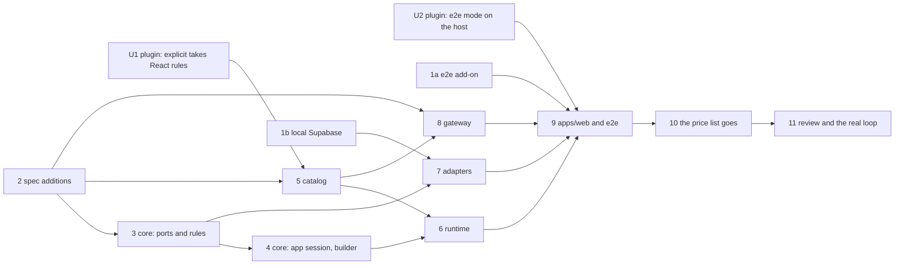

# The first slice: implementation plan

> **For agentic workers:** REQUIRED SUB-SKILL: Use superpowers:subagent-driven-development (recommended) or superpowers:executing-plans to implement this plan task-by-task. Steps use checkbox (`- [ ]`) syntax for tracking.

**Goal:** The loop of [FIRST-SLICE.md](../FIRST-SLICE.md), end to end: a
builder describes a book tracker, accepts a change set and an app, uses the
app in a dockview panel, reopens it, and revises it to a second version.

**Architecture:** `spec` holds the schemas and the pure functions over them.
`core` holds the ports, their simulators and contracts, the ontology's rules,
the session of an open app and the builder. `catalog` holds the components'
contracts and their React implementations; `runtime` renders a UI spec over
them. `adapters` implement the ports on a local Supabase and on the gateway.
`apps/gateway` calls the model and checks what it returns; `apps/web` is the
composition root and the shell.

**Tech stack:** TypeScript on Node 26, pnpm 12.6, Zod 4, RxJS 7, React 19
with the React Compiler, Vite 8, Tailwind 4 and shadcn's primitives,
dockview 8, the Supabase CLI and `@supabase/supabase-js` 2,
`@anthropic-ai/sdk`, Vitest 5, Playwright 1.63.

**Spec:** [FIRST-SLICE.md](../FIRST-SLICE.md), read with
[VISION.md](../VISION.md), [ARCHITECTURE.md](../ARCHITECTURE.md) and
ADR-0001 to ADR-0012. Where they leave a question open, "Decided here" says
what this plan chose. The author approves the plan before anything is built.

---

## Decided here

Each line is a choice the documents leave open. The column on the right says
which document the part that builds it changes. Overturn any of them in
review, and the parts that follow change with it.

| # | Question | Decision | Changes |
|---|---|---|---|
| 1 | How a prop says it accepts a `$view` or a `$state` (ADR-0002, "Not decided yet") | Each prop of a contract has a kind: `fixed`, `state` or `view`. See the next section | ADR-0002, in part 2 |
| 2 | Where a change set is applied | A pure `applyChangeSet` in `spec`, not in `core`: the gateway must check the model's app against the ontology as it will be after the change set, and it may import `spec` only | ARCHITECTURE.md's table, in part 2 |
| 3 | Who writes a binding's version | The model names types and actions; the gateway adds each one's version from the ontology the change set yields. The stored app carries versions as before | ADR-0011, in part 8 |
| 4 | Where an action is checked (ADR-0009) | In the adapter's `execute`, by a pure `planWrite` from `core` that the simulator and the Supabase adapter both call. Moving the check to the server later changes the adapter and no port | ADR-0009, in part 3 |
| 5 | The name of `core`'s compose function | `createCore`, with the one harness `createCoreHarness`. The kit's default is `createApp`, and "app" is a word the glossary pins to a saved spec | `architecture.config.mts`, in part 3 |
| 6 | Where an element's test id comes from | `runtime` derives it from the element's id: `spec.<id>`. A part of an element (a row, a field) adds `.<part>`. `apps/web`'s `testids.ts` has the same rule for the end-to-end tests, and a test holds the two equal | part 6, part 9 |
| 7 | How the local Supabase is installed and started | The CLI is a dev dependency of `adapters`, pinned like any other. The tests that need it are named `*.supabase.test.ts`. Where Docker is not running they are left out with a `SKIP` line; in CI they always run | ADR-0004, in part 1b |
| 8 | How the end-to-end tests reach a database | Two modes: `sim` (every port a simulator) and `stack` (a local Supabase, the model scripted). The `stack` mode cannot run in the Playwright container, which has no Docker, so the add-on gains a job on the host for such a mode, and a mode's variables read from the running stack | the plugin, in part U2 |
| 9 | Which lint rules hold the catalog's React code | A package of role `explicit` may name the role whose React rules it takes. The catalog takes `client`'s: it is compiled by `apps/web`'s build | the plugin, in part U1 |
| 10 | What the model is asked with | `claude-opus-5-5` at effort `high`, adaptive thinking, structured outputs, streamed, with Anthropic's server-side fallback on a refusal (`fallbacks: "default"`). Model and effort are the gateway's configuration | ADR-0011, in part 8 |
| 11 | How a workspace is saved | On adding or closing a panel and on moving a pin, each a new version. Dragging or resizing a panel is not saved in v1 | STATUS.md, in part 9 |
| 12 | How the builder signs in | E-mail and password. The local Supabase confirms no e-mail, so a fresh database takes a sign-up at once | part 9 |

Out of the slice, each with an entry in `docs/STATUS.md` when its part
merges: the gateway on Fly.io and a hosted Supabase (the loop runs on the
author's machine: a local Supabase, a local gateway, the real model); a
compatibility report given to the model; saving a dragged layout; a second
user; a database function that checks writes (ADR-0009).

## Settled: how a prop says what it accepts

A contract lists its props, each with one of three kinds:

| Kind | What the spec may hold | What the component receives |
|---|---|---|
| `fixed` | a JSON value the prop's schema accepts | that value |
| `state` | such a value, or `{"$state": "<key>"}` | the value, or the state key's current value |
| `view` | only `{"$view": "<view id>"}` | the view's rows, `readonly Row[]` |

```ts
// packages/catalog/src/contract/components/select.ts
export const Select = defineComponent({
  name: "Select",
  description: "Choose one of a few options. Emits the chosen value, or null for the empty choice.",
  props: {
    label: fixed(z.string().min(1)),
    options: fixed(z.array(z.string().min(1)).min(1)),
    emptyLabel: fixed(z.string().min(1)).optional(),
    value: state(z.string().nullable()),
  },
  events: { change: ["value"] },
});
```

What each half checks, and where:

- **`spec`, from data.** The manifest gives each component's props by kind
  and each event's payload fields. `checkApp` reports a prop the component
  does not have, a `$view` on a prop that is not `view`, a `$state` on a
  `fixed` prop, a `view` prop that holds anything but a `$view`, and a
  `$event` field the event does not carry. It still takes the ontology and the
  manifest as data.
- **`catalog`, with Zod.** `checkElement` parses each value a spec writes for a
  `fixed` or `state` prop against the prop's schema, and reports a required
  prop that is missing. A `Form` also checks that each `$event` in its submit
  handlers names one of its `fields`.
- **`validateApp` in `spec` runs both**: the schema, `checkApp`, then the
  catalog's `checkElement` for each element. `core` runs it before it saves
  an app, the gateway before it returns one.

The model is held to a schema built from the same contracts, one closed
object per component, with the `state` and `view` kinds written as `anyOf`
(ADR-0006). Its props never carry a `$event`: a handler does.

---

## Global constraints

- Node `>=26` (`devEngines`), pnpm `12.6.0`. No `engines.node` anywhere.
- Every package is declared in `architecture.config.mts` with its role before
  its first file. A new package has `typecheck` and `test` scripts and the
  `#/*` import alias.
- `spec` imports `zod` and nothing else. `core` imports `spec`, `rxjs`, `zod`.
  `catalog` imports `spec`, `zod`, `react` and what its implementation is built
  from; its `manifest` entry imports `spec` and `zod` only. `runtime` imports
  `spec`, `core`, `catalog`, `react`, `rxjs`. `adapters` imports `spec`,
  `core`, `@supabase/supabase-js`. `apps/web` imports `runtime`, `adapters`,
  `core`, `spec`, `react`, `react-dom`, `dockview`. `apps/gateway` imports
  `spec`, `@origamic/catalog/manifest`, `@anthropic-ai/sdk` and Node's
  built-ins.
- No `any`, no cast past a schema, no `z.any()`. A value from outside (a
  request, a row, a model's reply) is parsed by a schema of `spec` before it is
  used.
- A spec names no table, column or query. Only `adapters` does.
- A version in a binding is never left out: `Book@1`, `updateBook@2`.
- New dependencies at an exact version at least a day old
  (`minimumReleaseAge: 1440`); Playwright `1.63.0`, as the add-ons pin it.
- Each part ends with `pnpm gate:full` green and its entry in
  `docs/STATUS.md` updated, in its own pull request, shipped as `AGENTS.md`
  says.
- Tests come first in a test file. A test that needs the whole core asks
  `createCoreHarness`. A UI test talks to a page object. No test sleeps.

## Review focus

The five inputs most likely to break the loop that no criterion in
FIRST-SLICE.md exercises. Each has its test in the part that owns the code.

1. **A number compared as text.** JSONB read with `->>` compares `"10" < "9"`.
   A view filtering `rating gt 3` must return the 10, and sorting by rating
   must put 10 first. Test: the `ObjectStore` contract, part 3, run against
   Supabase in part 7.
2. **A model's reply that names what does not exist**: a `$event` field the
   event does not carry, a `$view` on a `fixed` prop. It must be found before
   anything renders, and retried once. Tests: part 2 (`checkApp`), part 5
   (`checkElement`), part 8 (the retry).
3. **Two proposals on the same base.** Accepting the second after the first
   must save nothing and say the ontology moved. Test: part 4, the builder.
4. **"Every status".** The filter's empty choice emits `null`, and a view
   whose filter reads a state key holding `null` returns every row. Tests:
   part 5 (`Select` emits `null`), part 4 (`resolveView` drops the filter).
5. **An object written at an older version of its type.** Updating a book
   written before `dateFinished` existed keeps its other values, and its row
   shows no date rather than an error. Test: part 3 (`planWrite`), part 4 (the
   app session).

---

## Pull requests, and what each waits for



1a, 1b, 2, U1 and U2 can start at once. 3 and 5 can run side by side, and
so can 7 and 8. Part 2 changes schemas the author reviewed line by line, so
its pull request waits for the author's review before it merges; the others
merge when green.

## Where each acceptance criterion is tested

| Criterion (FIRST-SLICE.md) | Test | Part |
|---|---|---|
| `spec`: an unknown `ObjectType@version` is rejected | `references.test.ts`, on main since #17 | done |
| `spec`: a component not in the manifest is rejected | `references.test.ts`, on main since #17 | done |
| `core`: `createBook` without a title writes nothing | `planWrite.test.ts`; the `ObjectStore` contract | 3 |
| `core`: a valid `createBook` emits one object through a subscribed view | `appSession.test.ts` | 4 |
| `core`: an app on ontology v1 loads on a compatible v2; a deprecated property gives a report | `compatibility.test.ts` | 3 |
| `adapters`: an object and a link round-trip; each contract passes; RLS denies another owner | `*.supabase.test.ts` | 7 |
| `runtime`: the saved spec renders a table with the two books | `AppView.test.tsx`, through `AppView.page.tsx` | 6 |
| `apps/web`: after a reload, the same panel with the same app version | `src/stack/reopen.spec.ts` | 9 |
| The gate fails an import of `adapters` in `runtime` | proved in #18; proved again before part 10 merges | 10 |

---

## Part U1 (plugin): a package of role `explicit` takes a role's React rules

In `bettersoftware-io/skills`, a worktree under `../skills-worktrees/`.

**Files:**
- Modify: `kit/files/tools/arch/gates/lib/config.mts` (a `reactRules?: "client" | "bindings"` on a declaration, allowed only with role `explicit`)
- Modify: `kit/files/tools/arch/check-react-policies.mts`, `kit/files/tools/arch/eslint.config.mts`
- Modify: `kit/README.md` ("The roles"), the example config, `docs/STATUS.md` (removes "The role `explicit` carries no React lint rules")
- Test: the kit's `gates.test.mts` and the React-policy tests beside it

- [ ] **Step 1: Write the failing tests.** `"an explicit package that imports React without reactRules is a finding"` (as today); `"an explicit package with reactRules: client gets the client's lint"` → the hook rules and the memo ban report in a fixture under it; `"reactRules on a package of another role is a configuration error"` → the message names the package.
- [ ] **Step 2: Run them, and see the second and third fail.** `node --test kit/tests/…` as the kit's README says.
- [ ] **Step 3: Implement.** The lint config picks the files of a package by its role, or by its `reactRules` when the role is `explicit`.
- [ ] **Step 4: Run the kit's tests and its mutation check** on the new branch of the condition.
- [ ] **Step 5: Ship it** as the plugin's `AGENTS.md` says, then bring the kit into Origamic in part 5 with `add-to-project.mts . kit`.

## Part U2 (plugin): an end-to-end mode that needs Docker runs on the host

The add-on's workflow runs every mode in the Playwright container, which has
no Docker, so no mode there can start a local Supabase. And a mode's build
variables are written in the config, where a local Supabase's keys must not
be: they are read from the running stack.

**Files:**
- Modify: `addons/e2e/files/tools/e2e/lib/config.mts` (a mode may say `host: true`, and its `env` may be an `async () => Record<string, string>`, called before the mode's server and build)
- Modify: `addons/e2e/files/tools/e2e/run.mts` (`--where container|host` picks the modes; no flag runs all, as now)
- Modify: `addons/e2e/files/.github/workflows/e2e.yml` (a second job on `ubuntu-latest` without the container, which installs Chromium with its system libraries at the pinned version and runs `pnpm e2e --where host`; the first runs `--where container`)
- Modify: the add-on's README and tests; `docs/STATUS.md`

- [ ] **Step 1: Write the failing tests.** `"--where host runs only the modes that say host"`; `"--where container runs the others"`; `"an env function runs before the server, and its failure exits 2 with the mode named"`; `"a config whose modes are all in the container needs no host job"` (the workflow's job then finds no mode, and says so with exit 0).
- [ ] **Step 2: Run them and see them fail.**
- [ ] **Step 3: Implement**, keeping the runner's rules: no command through `pnpm`, a process group for each program, every address read from what the program prints.
- [ ] **Step 4: Prove it in a scratch project** created with `create-project.mts`, with a `host` mode whose env function reads a value a script prints, in both jobs on GitHub.
- [ ] **Step 5: Ship it.** Bring it into Origamic in part 9 with `add-to-project.mts . e2e`.

## Part 1a: the `e2e` add-on, as it comes

**Files:** what `node <skills>/scripts/add-to-project.mts . e2e` writes;
`docs/STATUS.md`; FIRST-SLICE.md's "Before the slice" loses its first bullet.

- [ ] **Step 1:** Run the installer in the worktree, then `pnpm install`, `pnpm e2e:install`.
- [ ] **Step 2:** `pnpm e2e`. Expected: the add-on's five specs pass against the price list, in both modes.
- [ ] **Step 3:** `pnpm gate:full`, `pnpm lint:workflows`. Expected: green.
- [ ] **Step 4: Ship it**, and watch the `End-to-end` workflow on the merge commit.

The price list's specs stay until part 10. Part 9 replaces the modes.

## Part 1b: a local Supabase that the gate and CI start

**Files:**
- Modify: `packages/adapters/package.json` (`@supabase/supabase-js` `2.118.0`; dev: `supabase` CLI `2.121.0`, `vitest`; scripts `typecheck`, `test`, `supabase`)
- Modify: `pnpm-workspace.yaml` (`allowBuilds: supabase: true`, with what its install script does, read before it is allowed)
- Create: `packages/adapters/supabase/config.toml` (project `origamic`; e-mail sign-up without confirmation; studio, storage, realtime, edge runtime, analytics, image proxy and mail off)
- Create: `packages/adapters/supabase/migrations/20261016000000_objects_and_specs.sql`
- Create: `tools/supabase/localSupabase.mts`, `tools/supabase/globalSetup.mts`
- Create: `packages/adapters/vitest.config.ts`, `packages/adapters/src/schema.supabase.test.ts`
- Modify: `architecture.config.mts` (adapters leaves `packagesWithoutTests`), `pnpm-lock.yaml` (the hand-written importer goes), `.github/workflows/ci.yml` only if the gate cannot start Docker there as it is, `docs/STATUS.md`, FIRST-SLICE.md

**Interfaces:**
- Produces: `supabaseTestsToSkip(): Promise<string[]>` (empty when Docker answers or `CI` is set; otherwise `["**/*.supabase.test.ts"]`, and prints `SKIP supabase — Docker is not running here; the tests against a local Supabase were not run`); `startLocalSupabase(): Promise<LocalSupabase>` with `interface LocalSupabase { url: string; anonKey: string; serviceRoleKey: string }`, which starts the stack if it is not up, applies pending migrations (`supabase migration up`), leaves it running, and reads the keys from `supabase status -o json`; `globalSetup` puts them in `SUPABASE_URL`, `SUPABASE_ANON_KEY`, `SUPABASE_SERVICE_ROLE_KEY`.
- Produces: the tables, as ADR-0001 and ADR-0004 say. Every table has `owner uuid not null default auth.uid() references auth.users on delete cascade`, row-level security on, and one policy `for all to authenticated using (owner = (select auth.uid())) with check (owner = (select auth.uid()))`:
  - `ontology_versions (owner, version int, ontology jsonb, change jsonb, created_at)`, key `(owner, version)`
  - `objects (id uuid default gen_random_uuid(), owner, type text, type_version int, data jsonb, created_at, updated_at)`, indexes on `(owner, type)` and GIN on `data`
  - `links (id uuid, owner, link_type text, from_id uuid, to_id uuid, created_at, updated_at)`, both ends `references objects on delete cascade`
  - `apps (owner, id text, version int, spec jsonb, created_at)` and `workspaces (…the same)`, key `(owner, id, version)`

- [ ] **Step 1: Write the failing test** `schema.supabase.test.ts`, with two users made through the admin API with fresh e-mails:
  - `"an owner reads back the object they wrote"` → `select` returns the row with `type: "Book"`, `type_version: 1`.
  - `"another owner reads none of it"` → user B's `select` on `objects`, `links`, `ontology_versions`, `apps`, `workspaces` returns `[]`.
  - `"another owner cannot write into it"` → B's insert with `owner: A` fails with the RLS error code `42501`.
- [ ] **Step 2: Run it with Docker stopped.** Expected: the `SKIP` line, exit 0. With `CI=true` and Docker stopped: a failure that says Docker is needed.
- [ ] **Step 3: Write the migration and the two tools files.**
- [ ] **Step 4: Run it with Docker running.** Expected: three passes. Then `pnpm install --frozen-lockfile` and `pnpm gate:full`.
- [ ] **Step 5: Ship it.** Expected in CI: the `gate:full` step starts Supabase and runs the three tests. Note the step's time in the pull request: the first pull of the images is the slowest.

## Part 2: the spec's additions (the author reviews before merge)

**Files:**
- Modify: `packages/spec/src/common.ts` (`Json`, `JsonValue`)
- Modify: `packages/spec/src/references.ts` (`PropKind`, `CatalogComponent`, `CatalogManifest`, `Catalog`, `validateApp`; `checkApp` gains the wiring checks)
- Create: `packages/spec/src/change.ts` (`applyChangeSet`, `Applied`)
- Create: `packages/spec/src/rows.ts` (`Row`)
- Create: `packages/spec/src/generation.ts` (`GenerationRequest`, `GenerationEvent`, `Proposal`)
- Modify: `packages/spec/src/testing/bookTracker.ts` (`createBookApp` written to the five contracts of part 5: the form's `fields`, `mode` and `values`, the table's `columns` and `selected`, the filter's `emptyLabel`; `createCatalog` in the new shape; `createDateFinishedApp`, the revision of step 7)
- Test: `references.test.ts`, `change.test.ts`, `generation.test.ts`
- Modify: ADR-0002 (its "Not decided yet" becomes "Settled", with the table above), ARCHITECTURE.md (the `spec` row: "and applying a change set"), `docs/STATUS.md`

**Interfaces:**
- Produces:
  ```ts
  export type PropKind = "fixed" | "state" | "view";
  export interface CatalogComponent {
    props: Readonly<Record<string, PropKind>>;
    /** Event → the fields its payload carries; null when the fields come from the element's props (a Form's fields). */
    events: Readonly<Record<string, readonly string[] | null>>;
  }
  export type CatalogManifest = Readonly<Record<string, CatalogComponent>>;
  export interface Catalog {
    manifest: CatalogManifest;
    checkElement(id: string, element: Element): Problem[];
  }
  export function checkApp(app: AppDraft, ontology: Ontology, manifest: CatalogManifest): Problem[];
  export function validateApp(input: unknown, ontology: Ontology, catalog: Catalog):
    { kind: "valid"; app: AppDraft } | { kind: "invalid"; problems: Problem[] };
  export type Applied =
    | { kind: "applied"; ontology: Ontology }
    | { kind: "stale"; current: number }
    | { kind: "invalid"; problems: Problem[] };
  export function applyChangeSet(ontology: Ontology, change: ChangeSet): Applied;
  export interface Row { id: string; values: Readonly<Record<string, JsonValue>> }
  export const GenerationRequest; // { format: 1, intent: string (1..4000), ontology: Ontology, app?: App }
  export const GenerationEvent;   // progress { message } | proposal { proposal } | failed { message, problems }
  export const Proposal;          // { explanation: string, changeSet: ChangeSet | null, app: AppDraft }
  ```
  `validateApp` turns a schema error into problems with the same `path` and `message` shape, so a caller has one kind of answer.

- [ ] **Step 1: Write the failing tests for the wiring** (`references.test.ts`), on `createBookApp()` changed one place at a time:
  - `"a prop the component does not have is a problem"` → `table.props.colour = "red"` gives `{ path: "ui.elements.table.props.colour" }`.
  - `"a $view on a prop that is not a view is a problem"` → `statusFilter.props.label = { $view: "books" }`.
  - `"a $state on a fixed prop is a problem"` → `table.props.columns = { $state: "status" }`.
  - `"a view prop holds a $view and nothing else"` → `table.props.rows = []`.
  - `"a $event the event does not carry is a problem"` → `table.on.select[0].to = { $event: "row" }`; message names `id, values`.
  - `"a $event of an event whose fields come from props is the catalog's to check"` → the same change on `addForm`'s submit gives no problem from `checkApp`.
  - `"validateApp runs the schema, checkApp and the catalog, in that order"` → a stub catalog's `checkElement` is not called when the schema fails, and its problems are appended otherwise.
- [ ] **Step 2: Write the failing tests for `applyChangeSet`** (`change.test.ts`):
  - `"the date-finished change takes the book tracker from 1 to 2"` → `ontology.version === 2`, `Book.version === 2`, `updateBook.version === 2`, `createBook.version === 1`.
  - `"a type touched twice in one change set moves one version"` → two `addProperty` on `Book` → `Book.version === 2`.
  - `"a change written against an older version is stale"` → `baseVersion: 0` on v1 → `{ kind: "stale", current: 1 }`.
  - `"adding a type that exists is invalid"`, `"adding a property that exists is invalid"`, `"replacing an action that does not exist is invalid"`, `"deprecating the title property is invalid"` → each `kind: "invalid"` with the path of the operation (`operations.0`).
  - `"the result passes the Ontology schema"` → an `addActionType` that writes an unknown property is `invalid` with the refinement's message.
  - `"an empty ontology takes a first change set"` → from `{ version: 0, objectTypes: [] }` to `Book@1`.
- [ ] **Step 3: Write the failing tests for the wire** (`generation.test.ts`): a request without an intent, or with an intent of 4001 characters, is rejected; a proposal whose app fails `AppDraft` is rejected; each event kind round-trips through `JSON.stringify` and `parse`.
- [ ] **Step 4: Run them.** `pnpm --filter @origamic/spec test`. Expected: the new tests fail; the 34 old ones pass.
- [ ] **Step 5: Implement.** `applyChangeSet` works on a copy, bumps each type and action it touches once, sets `version: base + 1`, then parses the result with `Ontology` and turns its issues into problems.
- [ ] **Step 6: Run them, then the mutation check** on the version bump (`+ 1` to `+ 0`), the stale guard (`!==` to `===`) and each wiring condition. Expected: every mutant killed.
- [ ] **Step 7:** `pnpm gate:full`; amend ADR-0002 and ARCHITECTURE.md; open the pull request and stop for the author's review.

## Part 3: core, its ports and its rules

**Files:**
- Create: `packages/core/src/ports/{ontologyStore,objectStore,specLibrary,llmGateway,session}.ts`
- Create: `packages/core/src/ports/__contracts__/{OntologyStore,ObjectStore,SpecLibrary,LlmGateway,Session}Contract.ts`
- Create: `packages/core/src/simulators/{ontologyStore,objectStore,specLibrary,llmGateway,session}Simulator.ts`, each with its `.test.ts` running its contract
- Create: `packages/core/src/actions/planWrite.ts`, `packages/core/src/ontology/valueSchema.ts`, `packages/core/src/apps/compatibility.ts`
- Create: `packages/core/src/createCore.ts`, `packages/core/src/testing/coreHarness.ts`, `packages/core/src/index.ts`
- Modify: `packages/core/package.json` (`rxjs`, `zod`, `@origamic/spec`; `typecheck`, `test`), `architecture.config.mts` (`ports: "src/ports"`, `compose: "createCore"`, `appHarness: "src/testing/coreHarness.ts"`, `packages/core/src/simulators` among `adapters`, core leaves `packagesWithoutTests`), `pnpm-lock.yaml` (the importer is pnpm's now), ARCHITECTURE.md (the ports' outline, as below), ADR-0009 (where the check runs), `docs/STATUS.md`

**Interfaces:**
- Consumes: part 2's `Applied`, `applyChangeSet`, `Catalog`, `validateApp`, `GenerationRequest`, `GenerationEvent`, `Row`.
- Produces:
  ```ts
  export interface OntologyStore {
    /** The owner's latest ontology; an owner with none has { format: 1, version: 0, objectTypes: [] }. */
    current(): Observable<Ontology>;
    apply(change: ChangeSet): Promise<Applied>;
  }

  export type ObjectId = string;
  export interface StoredObject { id: ObjectId; type: string; typeVersion: number; values: Readonly<Record<string, JsonValue>> }
  export interface ViewQuery {
    type: string;
    filter: readonly { property: string; op: "eq" | "neq" | "contains" | "gt" | "lt"; value: JsonValue }[];
    sort: readonly { property: string; dir: "asc" | "desc" }[];
    limit?: number;
  }
  export interface ActionInvocation { action: string; version: number; target?: ObjectId; input: Readonly<Record<string, JsonValue>> }
  export type ActionResult = { kind: "done"; id: ObjectId } | { kind: "rejected"; problems: readonly Problem[] };
  export interface ObjectStore {
    /** Emits at once, and again after each action executed through this store. */
    view(query: ViewQuery): Observable<readonly StoredObject[]>;
    execute(invocation: ActionInvocation): Promise<ActionResult>;
  }

  export interface LibraryEntry { id: string; name: string; latest: number }
  export interface SpecLibrary {
    apps(): Observable<readonly LibraryEntry[]>;
    workspaces(): Observable<readonly LibraryEntry[]>;
    loadApp(id: string, version?: number): Promise<App | null>;
    saveApp(draft: AppDraft): Promise<App>;
    loadWorkspace(id: string, version?: number): Promise<Workspace | null>;
    saveWorkspace(draft: WorkspaceDraft): Promise<Workspace>;
  }

  export interface LlmGateway { generate(request: GenerationRequest): Observable<GenerationEvent> }

  export interface User { id: string; email: string }
  export type SignInResult = { kind: "signedIn"; user: User } | { kind: "refused"; message: string };
  export interface Session {
    user(): Observable<User | null>;
    signIn(email: string, password: string): Promise<SignInResult>;
    signUp(email: string, password: string): Promise<SignInResult>;
    signOut(): Promise<void>;
  }

  export type ObjectWrite =
    | { kind: "create"; type: string; typeVersion: number; values: Record<string, JsonValue> }
    | { kind: "update"; id: ObjectId; typeVersion: number; values: Record<string, JsonValue> }
    | { kind: "delete"; id: ObjectId }
    | { kind: "link"; linkType: string; from: ObjectId; to: ObjectId };
  export type PlannedWrite = { kind: "write"; write: ObjectWrite } | { kind: "rejected"; problems: Problem[] };
  export function planWrite(ontology: Ontology, invocation: ActionInvocation, target: StoredObject | null): PlannedWrite;

  export type Compatibility = { kind: "compatible" } | { kind: "report"; breaks: readonly Break[] };
  export interface Break { binding: string; property?: string; reason: "deprecated" | "missing" | "no longer set" }
  export function checkCompatibility(app: App, ontology: Ontology): Compatibility;

  export interface CoreDeps { ontology: OntologyStore; objects: ObjectStore; library: SpecLibrary; llm: LlmGateway; session: Session; catalog: Catalog }
  export function createCore(deps: CoreDeps): Core; // Core grows in part 4
  export function createCoreHarness(options?: CoreHarnessOptions): CoreHarness; // the simulators, a scripted LLM, a stub catalog
  ```
  `createObjectStoreSimulator(ontology: OntologyStore)` and the Supabase
  adapter both call `planWrite` inside `execute`: that is where an action is
  checked (decision 4). A simulator's harness for a contract makes its
  initial state; nothing else in a simulator is for tests.

- [ ] **Step 1: Write the contracts first**, each with the cases its adapters owe. `ObjectStore`'s, on the book tracker's ontology:
  - `"executing createBook with a valid input stores one object and returns its id"`
  - `"executing createBook without a title is rejected, and a view sees nothing"` → `{ kind: "rejected", problems: [{ path: "title" }] }`, the view emits `[]`.
  - `"a view emits again after an action through the same store"` → two emissions, the second with one object.
  - `"a numeric filter and sort compare numbers"` → ratings 4, 9 and 10: `gt 5` gives 9 and 10; `desc` gives 10, 9, 4. (Review focus 1.)
  - `"an update merges into the object and keeps what it does not set"`
  - `"an update of an object of another type, or of none, is rejected"`
  - `"a link between two objects is stored, and a delete takes its links with it"`
  `OntologyStore`'s: starts at version 0; applies the book change; a second change on the same base is `stale`; `current()` emits the applied ontology. `SpecLibrary`'s: the first save of an app is version 1, the next 2; the old version still loads; a missing id loads `null`; `apps()` emits the latest of each. `Session`'s: signed out at first; sign-up signs in; a wrong password is `refused`; sign-out emits `null`. `LlmGateway`'s: events arrive in order and the stream completes after a `proposal` or a `failed`.
- [ ] **Step 2: Write the failing tests for `planWrite`**, named for the rule each holds: required on the type; required by a rule; `range` 1 to 5 on `rating`; an integer property refuses `4.5`; an enum refuses `"maybe"`; a field the action does not set is refused; an invocation of `updateBook@1` against `updateBook@2` runs if every field it sets is still set, and is refused otherwise; a create fills a property's `default`; an update of a book written at `Book@1` keeps its values and writes `typeVersion: 2` (review focus 5).
- [ ] **Step 3: Write the failing tests for `checkCompatibility`**: the book app on ontology v1 against v2 after the date-finished change → `compatible`; against a v2 that deprecates `rating`, which the app's view sorts by or a handler sets → `report` with `{ binding: "Book@1", property: "rating", reason: "deprecated" }`; a bound type the ontology no longer has → `missing`.
- [ ] **Step 4: Run them.** Expected: they fail for want of the code.
- [ ] **Step 5: Implement** the ports, simulators, `valueSchema` (one Zod schema per property type, as ADR-0006 amended says), `planWrite`, `checkCompatibility`, `createCore` and the harness.
- [ ] **Step 6: Run the tests, `pnpm coverage` and the mutation check** on each rule of `planWrite` and each reason of `checkCompatibility`.
- [ ] **Step 7:** `pnpm gate:full`. Expected: `port-contracts` passes and names five ports, where it printed `SKIP` before.
- [ ] **Step 8: Ship it.**

## Part 4: core, the open app and the builder

**Files:**
- Create: `packages/core/src/apps/resolveView.ts`, `appSession.ts`
- Create: `packages/core/src/builder/{builder,describeChangeSet,diffApps}.ts`
- Create: `packages/core/src/workspace/workspacePresenter.ts`
- Modify: `packages/core/src/createCore.ts`, `coreHarness.ts`, `docs/STATUS.md`

**Interfaces:**
- Consumes: part 3's ports and `planWrite`; part 2's `Row`, `validateApp`, `applyChangeSet`.
- Produces:
  ```ts
  export type StateValues = Readonly<Record<string, JsonValue>>;
  export function resolveView(view: View, state: StateValues): ViewQuery;
  export interface AppSession {
    state(): Observable<StateValues>;
    rows(viewId: string): Observable<readonly Row[]>;   // defaults applied, deprecated properties left out
    problems(elementId: string): Observable<readonly Problem[]>;
    emit(elementId: string, event: string, payload: Readonly<Record<string, JsonValue>>): Promise<void>;
    close(): void;
  }
  export type BuilderState =
    | { kind: "idle"; target: BuilderTarget }
    | { kind: "generating"; target: BuilderTarget; progress: readonly string[] }
    | { kind: "proposed"; target: BuilderTarget; proposal: Proposal; changes: readonly string[]; diff: AppDiff }
    | { kind: "accepting"; target: BuilderTarget }
    | { kind: "failed"; target: BuilderTarget; message: string; problems: readonly Problem[] };
  export type BuilderTarget = { kind: "new" } | { kind: "revise"; panel: string; app: App };
  export interface Builder {
    state(): Observable<BuilderState>;
    target(target: BuilderTarget): void;
    ask(intent: string): void;
    accept(): Promise<void>;
    reject(): void;
  }
  export interface AppDiff { added: readonly string[]; removed: readonly string[]; changed: readonly string[] } // "element table", "view books", "binding Book@1 → Book@2"
  export function describeChangeSet(change: ChangeSet, ontology: Ontology): readonly string[]; // "Book: add dateFinished (date, optional)"
  export function diffApps(before: AppDraft | null, after: AppDraft): AppDiff;
  export interface WorkspacePresenter {
    workspace(): Observable<Workspace | null>;
    open(): Promise<void>;                          // the owner's latest workspace, or a new empty one
    addPanel(app: App): Promise<void>;
    closePanel(panel: string): Promise<void>;
    movePin(panel: string, app: App): Promise<void>;
  }
  export interface Core {
    session: Session; builder: Builder; workspace: WorkspacePresenter; library: SpecLibrary;
    openApp(app: App): AppSession;
    loadApp(id: string, version: number): Promise<{ app: App; compatibility: Compatibility } | null>;
  }
  ```
  A handler list runs in order. A `set` changes state at once. An `invoke`
  builds its input from the payload and the state, calls `execute`, and on
  `rejected` puts the problems on the element and stops the list. A problem
  is cleared by the element's next event. Accepting a proposal applies the
  change set first, then saves the app (ADR-0012), then adds a panel or moves
  the pin.

- [ ] **Step 1: Write the failing tests for `resolveView`**: a filter on a state key holding `null` is left out (review focus 4); one holding `"done"` becomes `eq "done"`; sort and limit pass through.
- [ ] **Step 2: Write the failing tests for the app session** (`appSession.test.ts`, through `createCoreHarness`):
  - `"submitting addForm with a title adds exactly one book to the table's view"` → `rows("books")` emits `[]`, then one row with `title: "Dune"` and `status: "want"` (the default). (Criterion 2.)
  - `"submitting addForm without a title writes nothing and puts the problem on the form"` → `problems("addForm")` emits `[{ path: "title" }]`, rows stay `[]`, and the `set` after the invoke did not run.
  - `"choosing a status filters the table, and the empty choice shows every book"`
  - `"selecting a row and saving editForm updates that book"` → the `rating` changes, the `title` stays.
  - `"a book written before dateFinished shows no date"` → the row's values have no `dateFinished` key. (Review focus 5.)
- [ ] **Step 3: Write the failing tests for the builder**:
  - `"asking shows the progress, then the proposal with its changes and its diff"` → `changes` contains `"Book: add type with title, author, status, rating"`, `diff.added` contains `"element table"`.
  - `"accepting a new app applies the change set, saves app version 1 and adds a panel"`
  - `"accepting a revision saves version 2, moves the pin, and version 1 still loads"` (FIRST-SLICE step 7)
  - `"accepting after the ontology moved saves nothing and says so"` → `failed`, message contains `"the ontology changed"`, `library.apps()` unchanged. (Review focus 3.)
  - `"a failed generation shows its message and its problems"`
  - `"rejecting returns to idle and saves nothing"`
- [ ] **Step 4: Write the failing tests for the workspace presenter**: `open()` with none saved creates one; each of `addPanel`, `closePanel`, `movePin` saves a new version; `open()` after that loads the latest, with the same pins.
- [ ] **Step 5: Run them; implement; run them; mutation check** on the handler loop's stop, the null-filter rule and the order of accept.
- [ ] **Step 6:** `pnpm gate:full`; ship it.

## Part 5: the catalog

**Files:**
- Create: `packages/catalog/src/contract/{props,defineComponent}.ts`, `contract/components/{stack,text,select,table,form}.ts`
- Create: `packages/catalog/src/manifest.ts` (the entry `@origamic/catalog/manifest`: `catalog`, `contracts`), `src/generation.ts` (`generationSchema`, `readGenerated`)
- Create: `packages/catalog/src/react/{envelope,testIds,implementations}.ts`, `react/{Stack,Text,Select,Table,Form}.tsx`, each with a `.page.tsx` and a `.test.tsx`
- Create: `packages/catalog/src/react/primitives/` (shadcn's `button`, `input`, `label`, `select`, `table`, `checkbox`, copied by its command line, brought to the project's style, nothing else)
- Modify: `packages/catalog/package.json` (exports `.` and `./manifest`; `zod`, `react`, the primitives' dependencies), `architecture.config.mts` (`reactRules: "client"`; `vendorOnlyIn` for each library a primitive brings: `packages/catalog` only), the kit (part U1), ADR-0010 (the five components), `docs/STATUS.md`

**Interfaces:**
- Consumes: part 2's `Catalog`, `Element`, `Row`, `Problem`, `ChangeSet`.
- Produces:
  ```ts
  export function fixed<T extends z.ZodType>(schema: T): PropContract<"fixed", T>;
  export function state<T extends z.ZodType>(schema: T): PropContract<"state", T>;
  export function view(): PropContract<"view", typeof RowsSchema>;
  export function defineComponent<P extends PropContracts, E extends EventContracts>(contract: { name: string; description: string; props: P; events: E }): ComponentContract<P, E>;
  export const catalog: Catalog;                 // manifest + checkElement, from the five contracts
  export function generationSchema(): JsonSchema; // what the model is held to (ADR-0006)
  export function readGenerated(value: unknown): { kind: "read"; generated: Generated } | { kind: "invalid"; problems: Problem[] };
  export interface Generated { explanation: string; operations: ChangeSet["operations"] | null; app: { name: string; types: string[]; actions: string[]; ui: z.input<typeof UiSpec> } }
  export type JsonSchema = ReturnType<typeof z.toJSONSchema>; // a type the gateway imports without importing zod

  // React side
  export interface Envelope<P> { props: P; children: ReactNode; emit: (event: string, payload: Readonly<Record<string, JsonValue>>) => void; testId: string; problems: readonly Problem[] }
  export const implementations: Readonly<Record<string, ComponentType<Envelope<never>>>>;
  export function partTestId(testId: string, part: string): string; // `${testId}.${part}`
  ```
  The five contracts, in Origamic's terms (ADR-0010):

  | Component | Props (kind) | Events (payload) |
  |---|---|---|
  | `Stack` | `gap` (fixed: `"small" \| "medium" \| "large"`, optional) | none |
  | `Text` | `text` (state: string), `tone` (fixed: `"body" \| "heading" \| "muted"`, optional) | none |
  | `Select` | `label`, `options`, `emptyLabel` (fixed), `value` (state: string or null) | `change` (`value`) |
  | `Table` | `rows` (view), `columns` (fixed: `{ property, label }[]`), `selected` (state: id or null) | `select` (`id`, `values`) |
  | `Form` | `fields` (fixed: `{ name, label, input: "text" \| "longText" \| "number" \| "select" \| "date" \| "checkbox", options? }[]`), `submitLabel` (fixed), `mode` (fixed: `"create" \| "edit"`), `values` (state: a record or null) | `submit` (one field per entry of `fields`) |

  The model's output names elements, views and state in arrays with an
  `id`, since a record cannot be held to a schema there (ADR-0011);
  `readGenerated` turns them into the spec's maps.

- [ ] **Step 1: Write the failing contract tests**: `checkElement` reports a `fixed` value its schema refuses (`Select` with `options: []`), a missing required prop, a `Form` submit `$event` that names no field; `catalog.manifest.Table` is `{ props: { rows: "view", columns: "fixed", selected: "state" }, events: { select: ["id", "values"] } }`; `generationSchema()` has `additionalProperties: false` on every object and no `$ref` that reaches itself (a walk of the schema; ADR-0011's limits); `readGenerated` of the book tracker written as the model would write it gives back `createBookApp()`'s `ui`.
- [ ] **Step 2: Write the failing component tests**, each through its page object, the test id from `partTestId`:
  - `Select`: choosing `"done"` emits `{ value: "done" }`; choosing the empty label emits `{ value: null }` (review focus 4).
  - `Table`: renders a row per `Row` with its columns; clicking a row emits `{ id, values }`; the selected row is marked.
  - `Form`: a number field emits a number, an empty one leaves the field out; `mode: "edit"` with `values: null` shows "Select a row to edit" and submits nothing; a problem with `path: "title"` shows beside the title field.
  - `Stack` renders its children in order; `Text` renders its text.
- [ ] **Step 3: Run them; implement; run them; `pnpm coverage`.** The primitives are covered by the tests of the components that use them, or they are not copied (ADR-0010).
- [ ] **Step 4:** `pnpm check:react-policies`. Expected: the catalog is held to `client`'s rules. Then `pnpm gate:full`; ship it.

## Part 6: the runtime

**Files:**
- Create: `packages/runtime/src/AppView.tsx`, `AppView.page.tsx`, `AppView.test.tsx`, `elementTestId.ts`
- Create: `packages/runtime/src/viewModel/{useObservable,createShellViewModel}.ts`, `ShellViewModelContext.tsx`
- Create: `packages/runtime/src/index.ts` (exports `AppView`, `createShellViewModel`, `elementTestId`, and `catalog` for the composition root, which may not name `catalog` itself)
- Modify: `packages/runtime/package.json`, `architecture.config.mts` (runtime leaves `packagesWithoutTests`), `docs/STATUS.md`

**Interfaces:**
- Consumes: part 4's `Core`, `AppSession`; part 5's `implementations`, `Envelope`, `partTestId`, `catalog`.
- Produces:
  ```ts
  export function elementTestId(elementId: string): string; // `spec.${elementId}`
  export function AppView(props: { app: App; session: AppSession }): ReactNode;
  export interface ShellViewModel {
    useUser(): User | null;
    useBuilder(): BuilderState;
    useWorkspace(): Workspace | null;
    useLibrary(): readonly LibraryEntry[];
    useAppSession(app: App): AppSession; // opened on mount, closed on unmount
  }
  export function createShellViewModel(core: Core): ShellViewModel;
  ```
  `AppView` rebuilds the tree from the flat map (ADR-0002), and for each
  element resolves its props by kind, hands the implementation an envelope,
  and routes `emit` to `session.emit(elementId, …)`. A component the
  implementations do not have renders a visible "unknown component" box: the
  checks keep it from happening, and a blank panel would hide it if they
  failed. RxJS meets React here only (the role `bindings`).

- [ ] **Step 1: Write the failing test** (`AppView.test.tsx`, the core from `createCoreHarness`, the app `createBookApp()` saved, two books added through its form): `"the saved spec renders a table with the two books"` → the page object's `bookTitles()` is `["Dune", "Emma"]`, read by `elementTestId("table")`. (Criterion 4.)
- [ ] **Step 2: Write the rest**: choosing `"done"` in the filter leaves the done books; the title problem shows under the form's field; an element whose component is unknown shows the box with its name.
- [ ] **Step 3: Run them; implement; run them; coverage; `pnpm gate:full`; ship it.**

## Part 7: the adapters

**Files:**
- Create: `packages/adapters/src/supabase/{createSupabase,supabaseSession,supabaseOntologyStore,supabaseObjectStore,supabaseSpecLibrary,rows}.ts`
- Create: `packages/adapters/src/gateway/httpLlmGateway.ts`
- Create: `packages/adapters/src/index.ts` (`createSupabaseAdapters`, `createHttpLlmGateway`)
- Test: `packages/adapters/src/supabase/*.supabase.test.ts`, each running its contract from `@origamic/core`
- Modify: `docs/STATUS.md`, ARCHITECTURE.md if a port's outline moved

**Interfaces:**
- Consumes: part 3's ports, contracts and `planWrite`; part 1b's tables and `LocalSupabase`.
- Produces:
  ```ts
  export interface SupabaseConfig { url: string; anonKey: string }
  export interface Adapters { session: Session; ontology: OntologyStore; objects: ObjectStore; library: SpecLibrary; accessToken(): Promise<string | null> }
  export function createSupabaseAdapters(config: SupabaseConfig): Adapters;
  export function createHttpLlmGateway(config: { url: string; accessToken: () => Promise<string | null> }): LlmGateway;
  ```
  Every row read is parsed by a schema of `spec` before it leaves the
  adapter: an ontology by `Ontology`, an app by `App`, an object's values
  as JSON. `execute` reads the owner's latest ontology and the target, calls
  `planWrite`, then writes. Saving the next version of an app reads the
  latest and inserts the next, and on a key conflict reads again, at most
  three times. A filter on a number compares the JSON value (`data->rating`),
  not its text. The gateway's client posts the request with the access token
  and reads its answer as one JSON event a line; a `401` becomes a `failed`
  event that says to sign in again.

- [ ] **Step 1: Write the tests**: each port's contract against its adapter, a fresh user per test file. Then `"an object and a link round-trip"` and `"a second owner reads none of the first's objects through the store"`. (Criterion 5.) The gateway's client is tested in part 8, against the gateway.
- [ ] **Step 2: Run them with Docker**; implement; run them; coverage; `pnpm gate:full`; ship it.

## Part 8: the gateway

**Files:**
- Create: `apps/gateway/package.json` (`@origamic/gateway`; `@origamic/spec`, `@origamic/catalog`, `@anthropic-ai/sdk` `0.135.0`; scripts `typecheck`, `test`, `start`), `tsconfig.json`, `vitest.config.ts` (part 1b's global setup, and its skip, for `verify.supabase.test.ts`)
- Create: `apps/gateway/src/main.ts` (reads the environment, starts the server, prints `gateway listening on http://…`), `server.ts`, `generate.ts`, `prompt.ts`, `resolveBindings.ts`, `model.ts`, `anthropicModel.ts`, `verify.ts`
- Create: `apps/gateway/src/testing/scriptedModel.ts`
- Test: `generate.test.ts`, `server.port.test.ts`, `verify.supabase.test.ts`
- Create: `packages/integration/src/llmGatewayOverHttp.port.test.ts`
- Modify: `pnpm-workspace.yaml` (`apps/*`), `architecture.config.mts` (`apps/gateway`: role `server`, `mayImport: ["packages/catalog"]`; `@anthropic-ai/sdk` only in `apps/gateway`), `tools/strict-lint/knip.jsonc` (`apps/*`), `tools/coverage.config.mts` (excludes `main.ts` and `anthropicModel.ts`, each with its reason), ADR-0011 (decisions 3 and 10), `docs/STATUS.md`

**Interfaces:**
- Consumes: part 2's `GenerationRequest`, `GenerationEvent`, `applyChangeSet`, `validateApp`; part 5's `catalog`, `generationSchema`, `readGenerated`; part 7's `createHttpLlmGateway`; part 3's `LlmGateway` contract.
- Produces:
  ```ts
  export interface ModelRequest { system: string; messages: readonly { role: "user" | "assistant"; content: string }[]; schema: JsonSchema }
  export type ModelReply = { kind: "json"; value: unknown } | { kind: "refused"; category: string | null } | { kind: "cut"; reason: string };
  export interface ModelClient { complete(request: ModelRequest): Promise<ModelReply> }
  export type VerifyCaller = (token: string) => Promise<{ kind: "user"; id: string } | { kind: "refused" }>;
  export interface GatewayDeps { verify: VerifyCaller; model: ModelClient; allowedOrigin: string }
  export function createGatewayServer(deps: GatewayDeps): Server; // POST /generate only
  export function generate(request: GenerationRequest, model: ModelClient): AsyncGenerator<GenerationEvent>;
  export function createAnthropicModel(config: { apiKey: string; model: string; effort: "low" | "medium" | "high" | "xhigh" | "max" }): ModelClient;
  export function createSupabaseVerifier(config: { url: string; anonKey: string }): VerifyCaller; // GET /auth/v1/user with the token
  export function createScriptedModel(replies: readonly ModelReply[]): ModelClient;
  ```
  `generate` asks the model once; reads the reply with `readGenerated`;
  makes the change set (`baseVersion` is the request's ontology version);
  applies it with `applyChangeSet` to get the ontology the app will run on;
  resolves each named type and action to its version there; gives a new
  app a fresh id and a revision the id it revises; and runs `validateApp`.
  Problems at any step go back to the model once, quoted with their paths.
  A second failure is a `failed` event with the problems. A refusal or a
  reply cut short is a `failed` event that says which. `anthropicModel.ts`
  streams `client.beta.messages.stream({ model, max_tokens: 64000, system,
  messages, thinking: { type: "adaptive" }, output_config: { effort, format:
  { type: "json_schema", schema } }, betas: ["server-side-fallback-2026-07-01"],
  fallbacks: "default" })` and takes `finalMessage()`; it checks
  `stop_reason` before it reads the content. No test in the gate calls it
  (ADR-0011).

- [ ] **Step 1: Write the failing tests for `generate`**, on scripted replies:
  - `"a valid reply becomes one proposal with versions in its bindings"` → the app binds `{ type: "Book", version: 1 }` and `{ action: "createBook", version: 1 }`; `changeSet.baseVersion === 0`.
  - `"a revision binds the versions the change set makes"` → after the date-finished change, `Book@2` and `updateBook@2`, and the app keeps its id.
  - `"a reply with a problem is retried once, with the problems in the second request"` → the scripted model's second request contains `ui.elements.table.on.select.0.to`. (Review focus 2.)
  - `"a second bad reply is a failed event with the problems"`
  - `"a refusal and a reply cut short are failed events that say which"`
  - `"progress comes before the proposal"` → `["progress", "progress", "proposal"]` kinds.
- [ ] **Step 2: Write the failing tests for the server** (`server.port.test.ts`, port 0): no token → `401`; a refused token → `401`; a request `GenerationRequest` refuses → `400` with its problems; another origin → no CORS header; a good request → `200`, `application/x-ndjson`, one event a line.
- [ ] **Step 3: Write `verify.supabase.test.ts`**: a fresh user's token → `user`; a made-up token → `refused`.
- [ ] **Step 4: Write `llmGatewayOverHttp.port.test.ts`**: the `LlmGateway` contract against `createHttpLlmGateway` talking to `createGatewayServer` with a scripted model and a verifier that accepts one token; and `"an expired token is a failed event that says to sign in again"`.
- [ ] **Step 5: Run them; implement; run them; coverage; mutation check** on the retry count and the version resolution.
- [ ] **Step 6: Run the real model once, by hand**, with the author's key: `ANTHROPIC_API_KEY=… node apps/gateway/src/main.ts`, and the book tracker's intent posted with a local user's token. Expected: a `proposal`. Write the outcome in the pull request; this is not a test of the gate.
- [ ] **Step 7:** `pnpm gate:full`; ship it.

## Part 9: the web app, and the loop in a browser

**Files:**
- Create: `apps/web/package.json` (`@origamic/web`; `@origamic/{spec,core,runtime,adapters}`, `react`, `react-dom`, `dockview` `8.5.1`, `tailwindcss` and `@tailwindcss/vite` `4.3.3`, the React Compiler's packages as the price list's client has them), `index.html`, `vite.config.ts`, `vitest.config.ts`, `vitest.setup.ts`, `tsconfig.json`
- Create: `apps/web/src/app/{main.tsx,startApp.tsx,composePorts.ts,devScript.ts,env.ts}`
- Create: `apps/web/src/ui/{Shell,SignIn,Builder,Proposal,Library,Workspace}.tsx`, each with a `.page.tsx` and a `.test.tsx`; `ui/dockviewSteps.ts`; `ui/testids.ts`; `index.css`
- Modify: `tools/e2e.config.mts` (the client `apps/web`; mode `sim` with no Supabase and no gateway; mode `stack` with `host: true` and an `env` that calls part 1b's `startLocalSupabase()` and passes `VITE_SUPABASE_URL` and `VITE_SUPABASE_ANON_KEY`, with no gateway, so the model is scripted), `packages/e2e/src/{sim,stack}/*.spec.ts`, `packages/e2e/src/pages/{Shell,SpecApp}.page.ts`
- Create: `tools/dev/stack.mts`; root `package.json` (`dev` → `apps/web` on simulators, `dev:stack` → `node tools/dev/stack.mts`)
- Modify: `architecture.config.mts` (`apps/web`: role `client`, `mayImport: ["packages/adapters"]`, `reactCompiler: true`, `entry: ["main.tsx", "index.css", "*.d.ts"]`; `dockview` only in `apps/web`; `react-dom` gains `apps/web`), the e2e add-on brought up to part U2, `tools/coverage.config.mts` (`apps/web/src/app/main.tsx`), AGENTS.md's commands, `docs/STATUS.md`

**Interfaces:**
- Consumes: part 6's `createShellViewModel`, `AppView`, `elementTestId`, `catalog`; part 7's `createSupabaseAdapters`, `createHttpLlmGateway`; part 3's simulators; part 4's `createCore`.
- Produces:
  ```ts
  export interface WebEnv { supabase?: { url: string; anonKey: string }; gatewayUrl?: string }
  export function composePorts(env: WebEnv): CoreDeps; // no Supabase: every port a simulator; no gateway: the LLM simulator on devScript
  export function startApp(env: WebEnv, root: HTMLElement): void;
  export type DockviewStep = { panel: string; title: string; position?: { referencePanel: string; direction: "right" | "below" | "within" } };
  export function toDockviewSteps(layout: Layout, titles: Readonly<Record<string, string>>): readonly DockviewStep[];
  export function specElementTestId(elementId: string): string; // in testids.ts, equal to runtime's elementTestId
  ```
  The shell: sign in or sign up; the builder beside the workspace, its target
  the active panel's app or a new one; a proposal shows the change set's
  lines and the app's diff, with Accept and Reject; the library lists the
  apps and opens one in a panel; a panel hosts `AppView` for its pinned
  version, and shows the compatibility report in place of the app when the
  check returns one. `devScript.ts` holds the two scripted proposals of the
  book tracker, for `pnpm dev` and the end-to-end tests.

- [ ] **Step 1: Write the failing unit tests**: `toDockviewSteps` for a panel, a split of two, and tabs; `specElementTestId("x") === elementTestId("x")`; the shell's page objects drive sign-in, a proposal's Accept, and the library's Open, on `createCoreHarness`'s ports through `composePorts({})`.
- [ ] **Step 2: Write the end-to-end specs.**
  - `src/sim/bookTracker.spec.ts`: `"the builder makes the book tracker, adds two books, and revises it"` → sign up; ask; the proposal lists `Book`; accept; the panel shows the app at version 1; add "Dune" and "Emma"; ask for the date; accept; the panel shows version 2 and both books, with no date.
  - `src/stack/reopen.spec.ts`: `"after a reload the workspace shows the same panel with the same app version"` (criterion 6) → sign up a fresh user on the local Supabase; make the app (the scripted model); add a book; reload; sign in if asked; the panel is there, at version 1, with the book.
- [ ] **Step 3: Run them**: `pnpm e2e --mode sim`, `pnpm e2e --mode stack`. Expected: they fail for want of the app.
- [ ] **Step 4: Implement**; run the unit tests, both modes, coverage, `pnpm gate:full`.
- [ ] **Step 5: Run `pnpm dev`** and walk the loop by hand on the simulators; then `pnpm dev:stack` with the real model (the author's key), on a database reset with `supabase db reset`. Write in the pull request what happened at each of the seven steps.
- [ ] **Step 6: Ship it**, and watch both end-to-end jobs on the merge commit.

## Part 10: the price list goes

**Files:**
- Delete: `packages/{domain,shared,client-core,react-bindings,client-react,server}`, the price list's tests in `packages/integration`, the price list's specs and page objects in `packages/e2e`
- Modify: `architecture.config.mts` (their lines; `requiredRoles: ["core"]`, since the kit requires a `domain` by default; the adapters folders of the price list; `vendorOnlyIn` for `ws`, `react-dom` and `react` without them; `compilerTracked` moves to a component of `apps/web` if one relies on the compiler, or goes), `tools/coverage.config.mts`, `tools/strict-lint/knip.jsonc`, root `package.json` (`dev:server`, `dev:fs`), `turbo.json` if it names them
- Modify: AGENTS.md (the layers table and "Where a thing goes" rewritten for Origamic's packages, with Origamic's own worked example in place of the price list's), ARCHITECTURE.md (the roles table: no over-grant left), FIRST-SLICE.md ("Before the slice" emptied), `docs/STATUS.md` (the over-grant leaves "Known limits")

- [ ] **Step 1: Prove the dependency rule once more**: an import of `@origamic/adapters` in `packages/runtime/src/AppView.tsx` → `pnpm gate:full` fails with the dependency finding; remove it.
- [ ] **Step 2: Delete, then run `pnpm gate:full` and both end-to-end modes.** Expected: green, with no `SKIP` but the ones the machine explains.
- [ ] **Step 3: Rewrite the documents**; `pnpm gate:full`; ship it.

## Part 11: the review, and the loop on a clean database

- [ ] **Step 1:** A fresh session, not the one that wrote the code, runs the plugin's `reviewing-architecture` skill over the diff from `fcbbd02` to main. Expected: nothing in the dependency rule or the three non-negotiables to object to. A finding is fixed in a pull request of its own before the slice is called done.
- [ ] **Step 2:** The author runs the loop with `pnpm dev:stack` on a database reset with `supabase db reset`, with the real model. Expected: the seven steps of FIRST-SLICE.md.
- [ ] **Step 3:** `docs/STATUS.md`: the slice leaves "In progress"; what is left of it goes where AGENTS.md says. HANDOVER.md's steps are done; it gets a line that says so.
